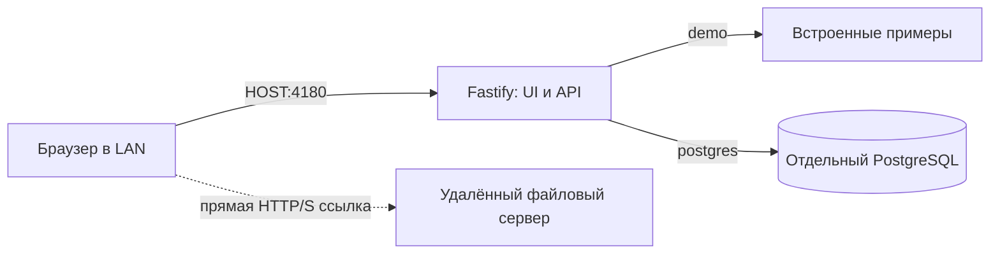

# Архитектура DONARIUM

DONARIUM — модульный монолит с одним production-процессом Node.js. Интерфейс собирается статически; Fastify отдаёт сборку и API. PostgreSQL хранит метаданные, обычное файловое хранилище на отдельном сервере — оригиналы. Между DONARIUM и SKUFnya нет подключения к БД, общей сети Compose, обязательных зависимостей или общих секретов.

## Решения и альтернативы

| Область | Выбор | Почему / альтернатива |
| --- | --- | --- |
| Репозиторий | npm workspaces: web, api, shared | Один lockfile и одна установка; отдельные репозитории и Turborepo пока не нужны |
| UI | React + Vite + React Router | Для личного каталога не нужны SEO и SSR Next.js; меньше серверных механизмов. Vue/Svelte пригодны, но не дают достаточной выгоды для смены знакомого React |
| API | Fastify 5 | JSON Schema-валидация, логирование и тестирование inject встроены. Express потребовал бы собирать эти части отдельно; NestJS увеличил бы объём соглашений |
| БД | PostgreSQL 16 | Ограничения связей, транзакции, UUID, FTS и pg_trgm. SQLite проще для маленькой коллекции, но PostgreSQL удобнее для будущего сканирования и интеграций |
| SQL | pg + явные SQL-миграции | Небольшая схема без генерации ORM-клиента; Prisma/Drizzle можно добавить позже при практической необходимости |
| Файлы | Ссылки на отдельный сервер; переносимые storage ID + relative path | Не переносим 2+ ТБ в контейнер или БД. Объектное хранилище/MinIO сейчас не требуется |
| Эксплуатация | Один Docker-контейнер + необязательная отдельная БД | Один LAN-порт, повторный запуск и healthcheck; nginx, Redis, Kubernetes не нужны |

Production использует Node.js 22 LTS. На обследованном хосте установлен Node.js 20, он не изменяется. Проверка известных уязвимостей выполнялась после установки; static-плагин обновлён до исправленной ветки 10.1.7+.

Источники технических решений: [Vite](https://vite.dev/guide/), [Node.js releases](https://nodejs.org/en/about/previous-releases), [Fastify LTS](https://fastify.dev/docs/latest/Reference/LTS/), [static plugin compatibility](https://github.com/fastify/fastify-static#compatibility), [параметризованные запросы pg](https://node-postgres.com/features/queries), [GIN для PostgreSQL FTS](https://www.postgresql.org/docs/16/textsearch-indexes.html). Выбор модульного монолита — проектное решение с учётом обслуживания одним человеком.

## Структура

```text
apps/
  web/
    public/illustrations/    собственные демонстрационные SVG
    src/api.ts              HTTP-клиент, загрузка, ошибки и отмена запросов
    src/components.tsx      карточка и общие состояния
    src/pages.tsx           главная, каталог, карточка, система, 404
    src/App.tsx             оболочка и маршрутизация
    src/styles.css          адаптивная тёмная тема
    vite.config.ts
  api/src/
    app.ts                  сборка Fastify без listen, static, health, ошибки
    server.ts               listen и корректное завершение
    config.ts               проверенная конфигурация окружения
    db.ts                   ограниченный пул PostgreSQL
    catalog/
      repository.ts         граница доступа к каталогу
      demo.ts               явные fixtures, без оригинальных файлов
      postgres.ts           параметризованные SQL-запросы
      routes.ts             HTTP-валидация и маршруты
packages/shared/src/index.ts общие DTO, версия, типы режимов
db/migrations/             номерные SQL, история и контрольные суммы
scripts/                    dev supervisor, миграции, seed
tests/                     API/безопасность, PostgreSQL и браузерные сценарии
Dockerfile                  сборка и непривилегированный production
compose.yml                 LAN-приложение
compose.postgres.yml        необязательная отдельная БД
.env.example                несекретный пример конфигурации
```

## Поток запросов



В dev Vite обслуживает UI и проксирует API к loopback-процессу Fastify. В браузере только относительные `/api/v1/*` и `/health`, поэтому разные устройства не требуют собственных API URL. CORS не включён, proxy-доверие выключено. Отдельный reverse proxy при необходимости можно добавить позже; сейчас единый адрес уже обеспечивается Fastify.

## API и границы

| Метод | Маршрут | Поведение |
| --- | --- | --- |
| GET | `/health` | Режим, версия, uptime; в postgres выполняет SELECT 1; при сбое 503 |
| GET | `/api/v1/system` | Несекретная конфигурация и доступные возможности |
| GET | `/api/v1/products` | q, category, sort, page, pageSize; записи, total и категории |
| GET | `/api/v1/products/:id` | UUID, карточка и связанные ресурсы |

`CatalogRepository` отделяет HTTP и UI от источника. `DATA_MODE` выбирается явно при запуске: сбой PostgreSQL не подменяется демо. API возвращает структурированные ошибки с requestId. Параметры валидируются JSON Schema, SQL получает значения через `$1…`, порядок сортировки — из разрешённого перечня. Лимит страницы — 100, page — до 10 000; сортировка включает UUID как дополнительный ключ. Для существенно более глубоких страниц следующим шагом станет cursor-pagination.

Модули файлов, переноса и настроек не разнесены по пустым каталогам: реальные файловые метаданные уже есть в схеме/DTO, read-only информация системы — маршрут Fastify, перенос пока документирован. По мере реализации эти части выделяются в `apps/api/src/storage` и `transfer` с отдельными сервисами.

## Модель данных

- `products`: независимая библиотечная карточка, UUID, SKU, текст, preview и даты.
- `categories` и `product_categories`: несколько категорий, задел под иерархию.
- `tags` и `product_tags`: теги, регистронезависимая уникальность.
- `assets`: изображения, модели, архивы, исходники и прочее; размер bigint, SHA-256, версия, путь/URL, связь с карточкой.
- `storage_locations`: стабильный UUID и ключ хранилища; фактические корни/адреса и секреты находятся в конфигурации отдельно от записей.
- `external_links`: будущая связь `system + external_id` с SKUFnya и другими системами, без внешних ключей в чужую базу.
- `schema_migrations`: история применённых файлов SQL и SHA-256.

Превью первого этапа — локальный `image_url` в продукте; несколько оригинальных изображений представляются `assets.kind=image`. В будущем отдельная операция выбора обложки свяжет производные изображения с asset. Сейчас браузерная CSP разрешает изображения только с собственного origin и data URI: удалённые изображения потребуют безопасного получения/кэша превью, а не произвольного ослабления CSP.

Поиск PostgreSQL использует GIN FTS (`simple` для смешанных языков/SKU), trigram-индекс для подстрок и отдельный индекс тегов. Отдельные Elasticsearch/Meilisearch не обязательны на этом этапе. Ограниченный пул, индексы фильтров и серверная пагинация позволяют начать без загрузки всего каталога в браузер. Нагрузочный тест на сотнях тысяч записей ещё не выполнялся.

## Хранение и безопасность

Ни сканирования, ни скачивания через backend пока нет. Поэтому приложение не получает произвольных путей файловой системы и не имеет доступа к 2 ТБ оригиналов. Прямая HTTP(S)-ссылка открывается в новой вкладке, без server-side запроса: серверные SSRF и проксирование сейчас не возникают. URL с login/password и протоколы javascript/file не допускаются интерфейсом. Чужой файловый сервер сам управляет доступом к оригиналам.

Перед реализацией локального скачивания потребуется разрешать UUID ресурса в заранее разрешённый storage root, проверять canonical realpath и symlink containment, запрещать абсолютные пути и `..`, проверять размер и диапазоны; не принимать путь клиента как имя файла. SQL-ограничение относительного пути — дополнительная проверка метаданных, не замена безопасному файловому адаптеру.

Сейчас чтение в доверенной LAN без логина, административные операции отсутствуют. Авторизация, защита сессий/CSRF, лимиты загрузки и права записи должны появиться одновременно с CRUD, а не после него. Docker работает под пользователем node, с read-only root FS, без capabilities и только с LAN-публикацией порта. Публичным является исключительно `apps/web/dist`. Нет маршрута для общего архива или `.env`.

## Следующие расширения

1. Авторизация единственного администратора и CRUD в PostgreSQL.
2. Реестр реальных удалённых хранилищ, безопасное разрешение относительных ссылок, редактор файловых связей и превью.
3. Версионированный экспорт/проверяемый импорт по DATA_PORTABILITY.md.
4. Фоновое сканирование разрешённых каталогов с заданиями/прогрессом и потоковым SHA-256; начать с отдельной команды/worker в этом репозитории, без обязательного Redis.
5. Дубликаты, 3D-превью и API-интеграция SKUFnya через `external_links`.
